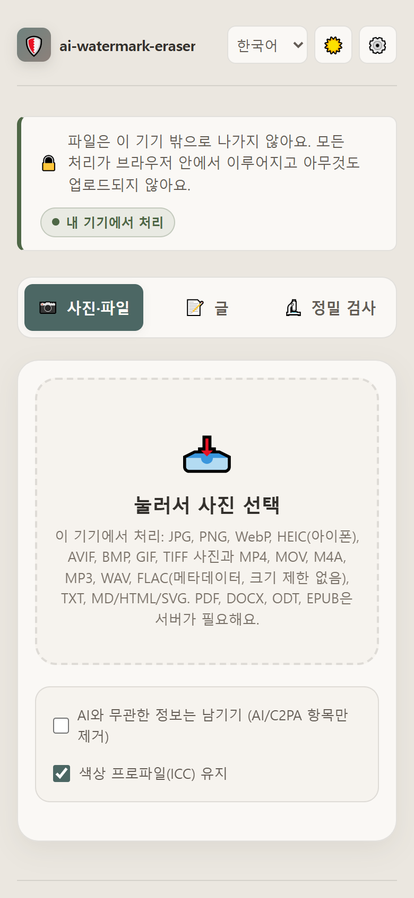

# ai-watermark-eraser

[](https://jmni817.github.io/ai-watermark-eraser/)
[](https://hits.sh/github.com/jmni817/ai-watermark-eraser/)
[](LICENSE)

**사진과 글의 AI 태그를 제거하는 프로그램**

AI로 만들거나 편집한 사진에는 "AI가 만들었음"을 알리는 메타데이터(C2PA 콘텐츠 자격 증명, EXIF/XMP의 `DigitalSourceType`, Stable Diffusion 프롬프트 등)가 함께 저장됩니다. AI가 쓴 글에는 눈에 보이지 않는 유니코드 문자가 섞여 있기도 합니다. ai-watermark-eraser는 이런 흔적을 **스마트폰 브라우저 안에서** 지워 줍니다. 사진은 서버로 올라가지 않습니다.

- 데모: https://jmni817.github.io/ai-watermark-eraser/
- 기반 프로젝트: [ivanusto/unmark-web](https://github.com/ivanusto/unmark-web) (MIT)

<picture>
  <source media="(prefers-color-scheme: dark)" srcset="docs/screenshot-mobile-ko-dark.png">
  
</picture>

## 주요 기능

| 대상 | 하는 일 |
| --- | --- |
| 사진 (JPG, PNG, WebP, HEIC, AVIF 등) | C2PA, EXIF, XMP, PNG 텍스트 청크 등 메타데이터 블록을 제거합니다. 픽셀은 다시 인코딩하지 않으므로 화질이 그대로입니다. |
| 글 | 제로폭 문자, 방향 제어 문자 같은 보이지 않는 유니코드와 특수 공백을 정리합니다. 이모지나 한글 채움 문자처럼 필요한 문자는 남깁니다. |
| 정밀 검사 | 파일이나 글에 남아 있는 AI 흔적을 종류별로 보여 줍니다. |
| 동영상·음성 (MP4, MOV, MP3, WAV 등) | 메타데이터만 제거하고 영상과 소리는 건드리지 않습니다. |

**지우지 못하는 것**: 이미지 픽셀 자체에 새겨진 워터마크(SynthID 등)와 화면에 보이는 로고 워터마크는 메타데이터가 아니라서 이 프로그램으로 제거되지 않습니다. 정밀 검사 탭은 이런 한계를 숨기지 않고 따로 표시합니다.

## 사용 방법

1. 휴대폰에서 데모 페이지를 엽니다.
2. **사진·파일** 탭에서 "눌러서 사진 선택"을 누르고 사진을 고릅니다.
3. 처리가 끝나면 **사진에 저장 / 공유**를 눌러 갤러리에 저장합니다. 이 버튼을 지원하지 않는 브라우저에서는 **다운로드**를 누르면 됩니다.

## 원작과 달라진 점

[ivanusto/unmark-web](https://github.com/ivanusto/unmark-web)의 엔진은 그대로 쓰고, 한국 사용자와 모바일 환경에 맞춰 다음을 바꿨습니다.

- **한국어 지원**: 화면 문구 230개를 번역했고, 한국어를 기본 언어로 설정했습니다. 원작의 다국어 키 일치 테스트를 통과합니다.
- **모바일 우선 화면**: 가장 많이 쓰는 사진 탭을 첫 화면으로 옮겼습니다. 탭과 버튼은 엄지로 누르기 쉬운 크기(44~48px)로 키웠고, 375px 폭에서도 가로 스크롤이 생기지 않습니다. 한글이 어절 단위로 줄바꿈되도록 `word-break: keep-all`을 적용했습니다.
- **한글 시스템 폰트**: Apple SD Gothic Neo, Noto Sans KR, 맑은 고딕 순으로 기기에 있는 폰트를 씁니다. 원작의 "외부 요청 없음" 원칙을 지키려고 웹폰트는 쓰지 않았습니다.
- **사진에 바로 저장**: Web Share API로 공유 시트를 열어 갤러리에 저장할 수 있게 했습니다. 다운로드 폴더를 거치지 않아도 됩니다.
- **색상 프로파일 유지 옵션**: 아이폰의 Display P3 사진은 ICC 프로파일을 지우면 색이 바랩니다. AI 표시가 없는 ICC 프로파일은 남기는 옵션을 추가하고 기본으로 켰습니다. 엔진의 기본 동작은 바꾸지 않아서 원작과의 동일성(parity) 테스트는 그대로 통과합니다.
- **Windows 로컬 서버 수정**: Windows 레지스트리가 `.js`를 `text/plain`으로 등록해 둔 환경에서 스크립트가 실행되지 않던 문제를 `serve_local.py`에서 고쳤습니다.

## 구조

빌드 과정이 없는 정적 웹사이트입니다(HTML, CSS, 순수 JavaScript).

```
index.html            화면
css/app.css           스타일 (끝부분에 한국어·모바일 레이어)
js/i18n.js            다국어 문구 (ko, en, zh-Hant, zh-Hans)
js/app.js             화면 동작, 저장/공유
js/engine.js          Web Worker 실행
js/worker.js          Web Worker 본체
js/engine_ops.js      Worker 안에서 돌아가는 작업
js/image_meta.js      사진 메타데이터 제거 (원작 Python 코드의 JS 이식)
js/layer_a.js         보이지 않는 유니코드 제거
js/av_meta.js         동영상·음성 메타데이터 제거
serve_local.py        로컬 개발용 서버
tests/                원작과의 동일성 테스트, 다국어 키 테스트
```

사진은 `File` 객체를 바이트 배열로 읽어 컨테이너 구조(JPEG 세그먼트, PNG 청크, RIFF 청크, ISOBMFF 박스)를 따라가며 메타데이터 블록만 잘라냅니다. 캔버스로 다시 그리지 않으므로 픽셀 데이터는 원본과 같습니다.

## 로컬에서 실행

```bash
python serve_local.py
```

브라우저에서 `http://127.0.0.1:8766`을 엽니다. `index.html`을 직접 열어도 동작합니다.

테스트:

```bash
pip install -r requirements-dev.txt
git clone https://github.com/guillaumemeyer/watermarks-remover upstream
WATERMARKS_UPSTREAM_DIR="$PWD/upstream" pytest tests/ -q
```

## 앞으로 할 일

- 실제 아이폰과 갤럭시에서 공유 저장, HEIC 처리 확인
- Capacitor로 감싸 Android, iOS 앱으로 출시

## 크레딧과 라이선스

이 프로젝트는 [ivanusto/unmark-web](https://github.com/ivanusto/unmark-web)(MIT)을 기반으로 하며, 그 엔진은 [guillaumemeyer/watermarks-remover](https://github.com/guillaumemeyer/watermarks-remover)(MIT)의 규칙을 JavaScript로 옮긴 것입니다. 두 프로젝트와 공식적인 관계는 없습니다.

- 라이선스: [MIT](LICENSE). 원작자의 저작권 표시는 [LICENSE](LICENSE)와 [NOTICE](NOTICE)에 그대로 남겨 두었습니다.
- 원작 README(영문, 기능과 엔진에 대한 자세한 설명): [README.upstream.md](README.upstream.md) · [繁體中文](README.upstream.zh-TW.md)
